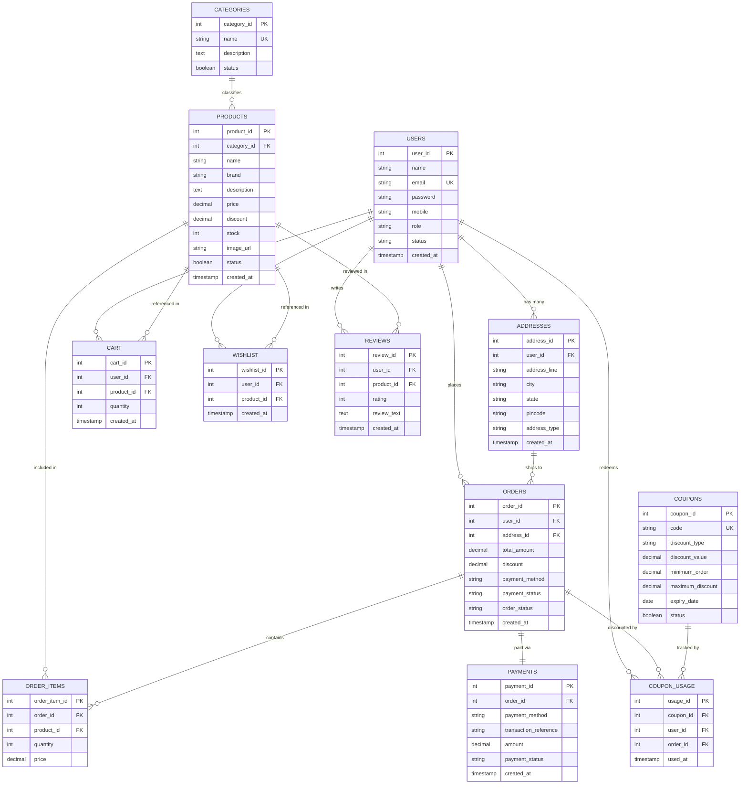

# ShopSphere - Database Design & Data Dictionary

## 1. Entity-Relationship (ER) Diagram

---

## 2. Table Data Dictionaries

### 2.1 `users`
| Column | Type | Constraints | Description |
|---|---|---|---|
| `user_id` | INT | PRIMARY KEY, AUTO_INCREMENT | Unique user identifier |
| `name` | VARCHAR(100) | NOT NULL | Full name of the user |
| `email` | VARCHAR(150) | NOT NULL, UNIQUE, INDEX | Unique email address used for login |
| `password` | VARCHAR(255) | NOT NULL | SHA-256 cryptographic password hash |
| `mobile` | VARCHAR(20) | NULL | Contact mobile number |
| `role` | VARCHAR(20) | NOT NULL, DEFAULT 'CUSTOMER' | Authorization role: 'ADMIN', 'CUSTOMER' |
| `status` | VARCHAR(20) | NOT NULL, DEFAULT 'ACTIVE' | Account state: 'ACTIVE', 'INACTIVE' |
| `created_at` | TIMESTAMP | DEFAULT CURRENT_TIMESTAMP | Registration timestamp |

### 2.2 `products`
| Column | Type | Constraints | Description |
|---|---|---|---|
| `product_id` | INT | PRIMARY KEY, AUTO_INCREMENT | Unique product identifier |
| `category_id` | INT | NOT NULL, FK -> categories | Category foreign key constraint |
| `name` | VARCHAR(255) | NOT NULL | Product marketing title |
| `brand` | VARCHAR(100) | NULL | Manufacturer or brand name |
| `description` | TEXT | NULL | Full product specifications |
| `price` | DECIMAL(10,2) | NOT NULL | Base catalog price in INR |
| `discount` | DECIMAL(5,2) | DEFAULT 0.00 | Promotional discount percentage (e.g. 15.00) |
| `stock` | INT | NOT NULL, DEFAULT 0 | Available inventory stock count |
| `image_url` | VARCHAR(500) | NULL | High-resolution image asset URL |
| `status` | BOOLEAN | DEFAULT TRUE | Visibility flag in public catalog |
| `created_at` | TIMESTAMP | DEFAULT CURRENT_TIMESTAMP | Product creation timestamp |

### 2.3 `orders`
| Column | Type | Constraints | Description |
|---|---|---|---|
| `order_id` | INT | PRIMARY KEY, AUTO_INCREMENT | Unique order reference number |
| `user_id` | INT | NOT NULL, FK -> users | Purchaser foreign key |
| `address_id` | INT | NULL, FK -> addresses | Shipping destination address |
| `total_amount`| DECIMAL(10,2) | NOT NULL | Grand total after discount and shipping |
| `discount` | DECIMAL(10,2) | DEFAULT 0.00 | Total monetary discount applied |
| `payment_method` | VARCHAR(50)| DEFAULT 'CREDIT_CARD' | 'CREDIT_CARD', 'UPI', 'NET_BANKING', 'COD' |
| `payment_status` | VARCHAR(50)| DEFAULT 'PENDING' | 'PAID', 'PENDING', 'FAILED' |
| `order_status` | VARCHAR(50)  | DEFAULT 'PLACED' | 'PLACED', 'CONFIRMED', 'SHIPPED', 'DELIVERED', 'CANCELLED' |
| `created_at` | TIMESTAMP | DEFAULT CURRENT_TIMESTAMP | Order submission timestamp |

### 2.4 `coupons` & `coupon_usage`
- `coupons.code`: Unique indexed uppercase coupon code (`WELCOME10`, `FESTIVE20`, `FLAT500`).
- `coupons.discount_type`: 'PERCENTAGE' or 'FLAT'.
- `coupons.maximum_discount`: Cap for percentage discounts.
- `coupon_usage`: Prevents repeated redemption by linking (`coupon_id`, `user_id`, `order_id`).

---

## 3. Transaction Management Strategy

Checkout placement executes in an atomic JDBC transaction:
1. `conn.setAutoCommit(false);`
2. Stock reduction with `UPDATE products SET stock = stock - ? WHERE product_id = ? AND stock >= ?`.
3. Order and order_item persistence.
4. Mock payment record creation.
5. Cart clearance with `DELETE FROM cart WHERE user_id = ?`.
6. `conn.commit();`
7. In case of `SQLException`, automatic rollback: `conn.rollback();`.
