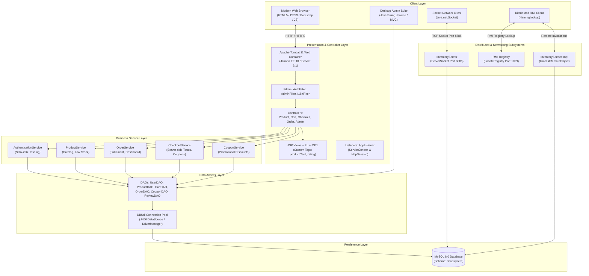
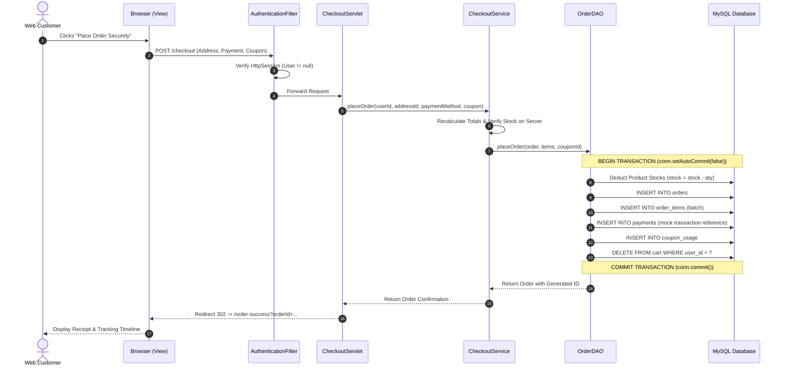

# ShopSphere - System Architecture & Technical Design

## 1. High-Level System Architecture

ShopSphere is designed around a modern **N-Tier Enterprise Architecture** adhering to RTU Advanced Java standards. The platform decouples presentation, controller, business services, data access, and database storage. In addition to the web store, desktop and distributed network services connect through JDBC, TCP Sockets, and Java RMI.

---

## 2. N-Tier Web Layered Architecture

---

## 3. Security Architecture

1. **Authentication:**
   - Passwords hashed using cryptographically secure **SHA-256** with hexadecimal digest encoding. Plaintext passwords are never persisted in the database or stored in cookies.
2. **Session State:**
   - `HttpSession` tracks authenticated identity and security roles (`ADMIN`, `CUSTOMER`). Cookies are strictly used for non-sensitive convenience functions (remembering login email, recently viewed product IDs).
3. **Role-Based Authorization:**
   - `AuthenticationFilter` guards customer transactions (`/cart`, `/checkout`, `/orders`, `/profile`, `/wishlist`).
   - `AdminFilter` intercepts and strictly restricts `/admin/*` routes to accounts bearing the `ADMIN` role.
4. **Data Integrity & SQL Injection Defense:**
   - 100% of SQL statements across all DAOs use `PreparedStatement` with typed parameters (`ps.setInt`, `ps.setString`, `ps.setDouble`). Zero string concatenation is used in queries.
5. **Server-Side Pricing Authority:**
   - Grand totals, shipping fees, product discounts, and coupon calculations are strictly re-evaluated and enforced on the server. Browser-submitted prices are ignored.
